<p align="center">
  
</p>

<h1 align="center">Executioner</h1>

<p align="center">
  <a href="https://github.com/dbx0/executioner/stargazers"></a>
  <a href="https://github.com/dbx0/executioner/releases"></a>
  
  
  
</p>

<p align="center">
  <strong>The agentic pentesting environment that lives on your machine.</strong><br/>
  Hand an assessment to a team of AI agents, give them your tools, and watch targets, findings and evidence land in one place.<br/>
  There is no cloud service and no account to create.
</p>

<h3 align="center"><a href="https://github.com/dbx0/executioner/releases/latest"><ins>Download Executioner</ins></a> · <a href="docs/assets/demo.mp4"><ins>Watch the 80 second demo</ins></a></h3>

<p align="center">
  <picture>
    <source srcset="docs/assets/hero.gif" type="image/gif" />
    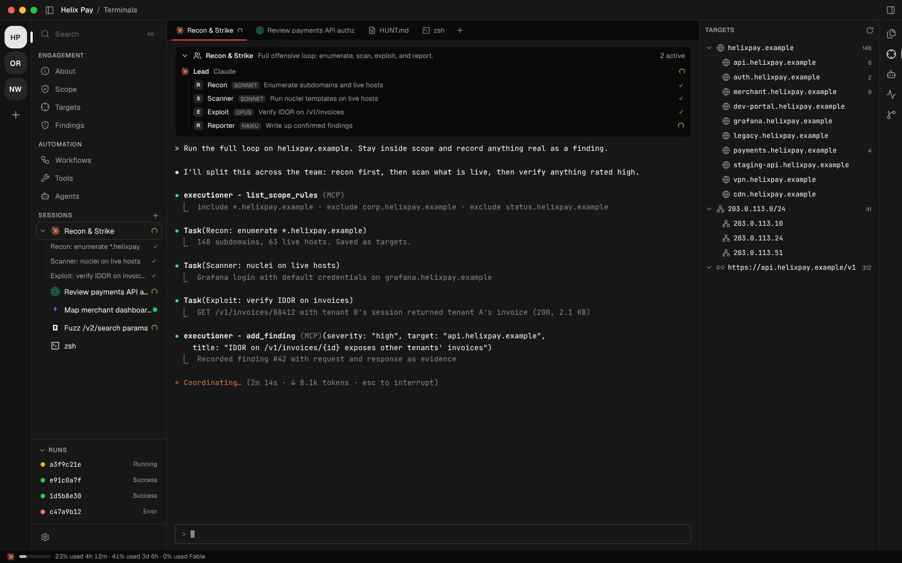
  </picture>
</p>


## Why Executioner

Most of a pentest is recon and taking notes: which hosts are in scope, what ran against them, what came back, which of the 400 lines of scanner output matters, and where the screenshot for finding #12 went. Agents are good at running tools and bad at keeping track of what happened last session.

In Executioner every engagement is a workspace with its own scope, targets, findings, workflows and evidence, and every agent you launch inside it can read and write all of it. You decide what runs, and the agents do the repetitive work.

## Features

### Agent teams that share notes

Launch Claude Code, Codex, Gemini, Cursor, OpenCode or Hermes straight into an engagement. Each one arrives already briefed and already connected to the engagement's scope, targets, findings and workflows, so a recon agent's subdomains are there for the exploit agent five minutes later.

One click starts a whole team. Recon & Strike enumerates, scans, exploits and writes the report, Web AppSec covers the OWASP surface, and Code Audit reviews a codebase. The sidebar shows each sub-agent's status as it works, and you get a notification when one needs your input.

<p align="center">
  <picture>
    <source srcset="docs/assets/features/agents.gif" type="image/gif" />
    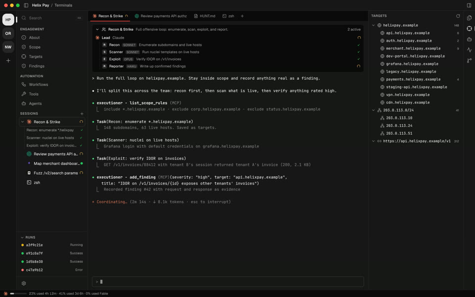
  </picture>
</p>

### Describe a workflow and let the assistant draft it

Tell the assistant what you want in plain words: *"when a new subdomain shows up, probe it, screenshot it and have Claude look for login pages."* It proposes a graph, and once you've reviewed it, one click puts it on the canvas.

<p align="center">
  <picture>
    <source srcset="docs/assets/features/assistant.gif" type="image/gif" />
    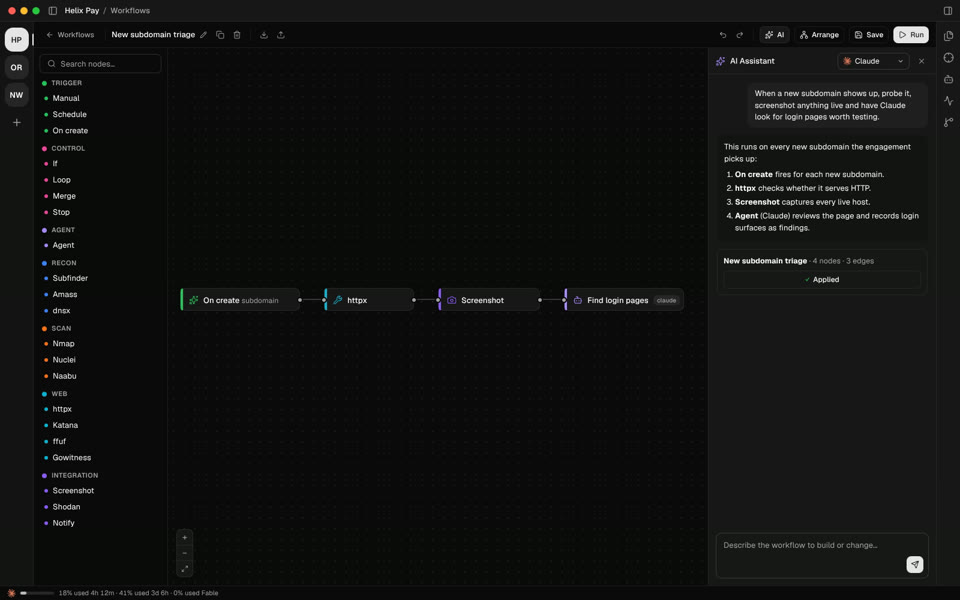
  </picture>
</p>

### Visual workflows

Chain tools, conditions, loops and AI agents on a canvas. Run them by hand, on a schedule, or every time a new target appears. Step through node by node when you want to see exactly what happens, and watch every result flow into targets and findings when you don't.

<p align="center">
  <picture>
    <source srcset="docs/assets/features/workflow.gif" type="image/gif" />
    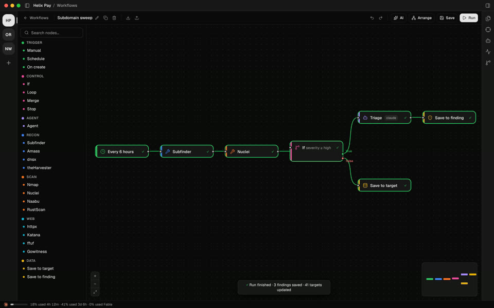
  </picture>
</p>

### Findings you can hand to a triager

Agents, workflows and you all write to the same findings list. Each one carries severity, status, the target it hit, who recorded it and the raw request and response as evidence. Triage them in place, then export a report you can submit with one click.

<p align="center">
  <picture>
    <source srcset="docs/assets/features/findings.gif" type="image/gif" />
    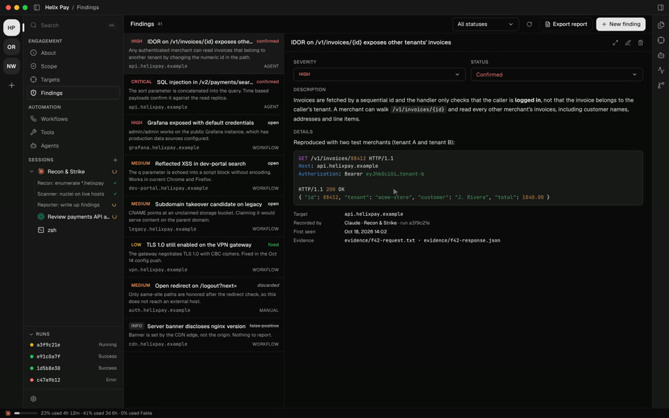
  </picture>
</p>

<table>
<tr>
<td width="50%" valign="middle">

### All your assets in one tree

Domains, subdomains, IPs, ranges and URLs land in a single tree as tools and agents discover them. Open any target to see its ports, technologies, HTTP services, WHOIS, screenshots and every finding against it.

</td>
<td width="50%">
  <picture><source srcset="docs/assets/features/targets.gif" type="image/gif" />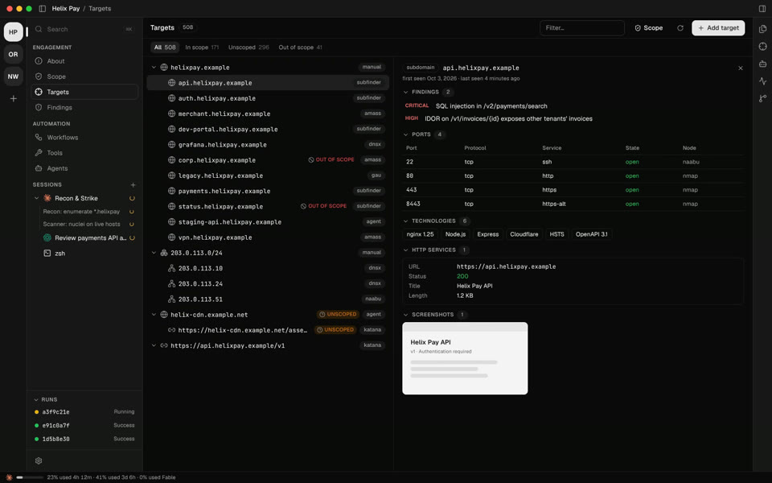</picture>
</td>
</tr>
<tr>
<td width="50%" valign="middle">

### Scope from the program page

Paste the scope section from HackerOne, Bugcrowd or the policy page and let AI turn it into include and exclude rules. Every target is judged against them instantly, and out of scope assets are flagged before anything touches them.

</td>
<td width="50%">
  <picture><source srcset="docs/assets/features/scope.gif" type="image/gif" />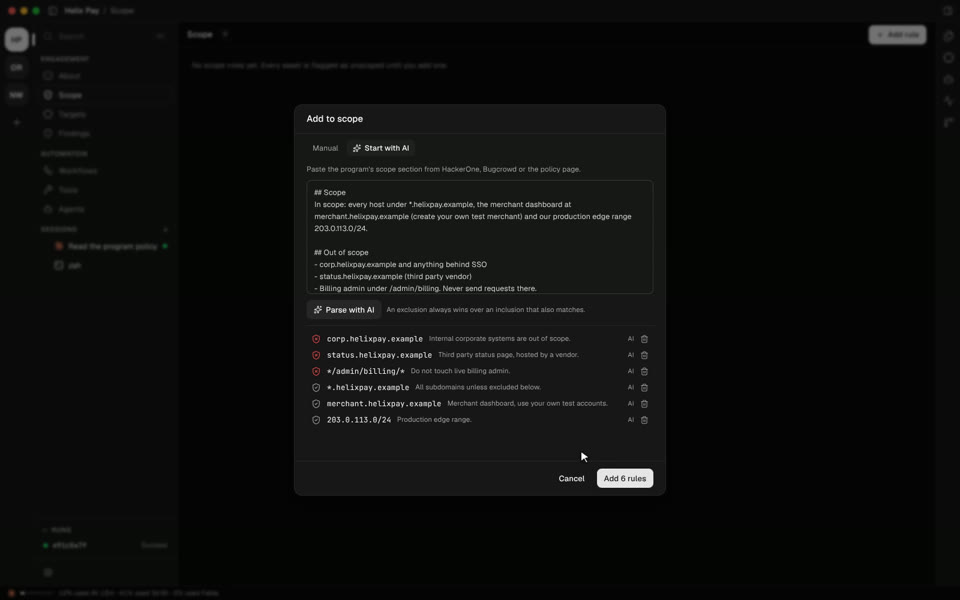</picture>
</td>
</tr>
<tr>
<td width="50%" valign="middle">

### Run tools here or on a remote box

Each of the 33 tools gets a form, so you don't need the man page. Pick targets, set the flags, check the exact command, then run it on this machine, over SSH, or inside a Kali container. The output is parsed into targets.

</td>
<td width="50%">
  <picture><source srcset="docs/assets/features/tools.gif" type="image/gif" />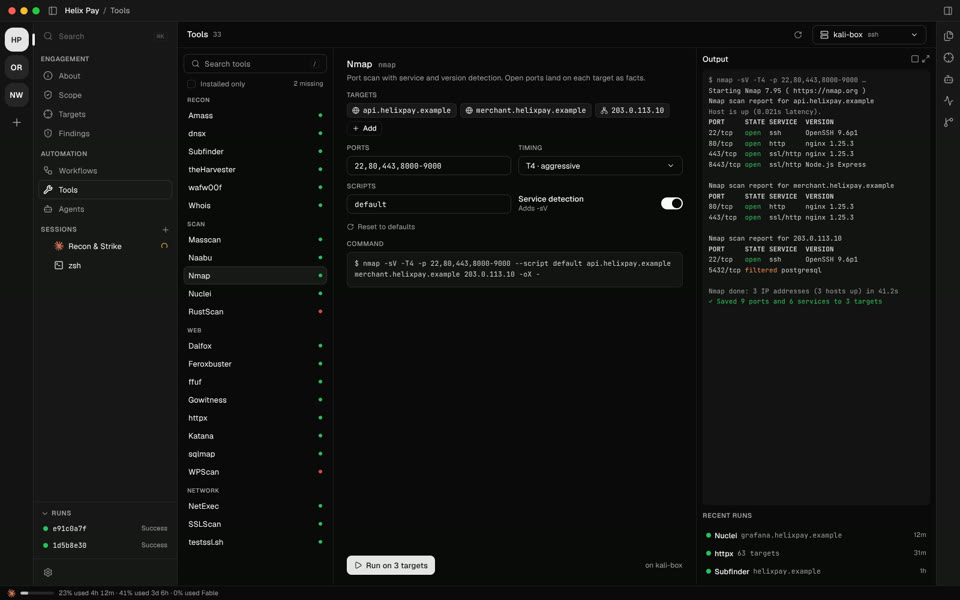</picture>
</td>
</tr>
<tr>
<td width="50%" valign="middle">

### One keystroke from anything

Press <kbd>⌘</kbd> <kbd>K</kbd> to jump to any target, finding, chat or view. Keep a scratchpad floating over everything for the payloads and notes you don't want to lose.

</td>
<td width="50%">
  <picture><source srcset="docs/assets/features/palette.gif" type="image/gif" />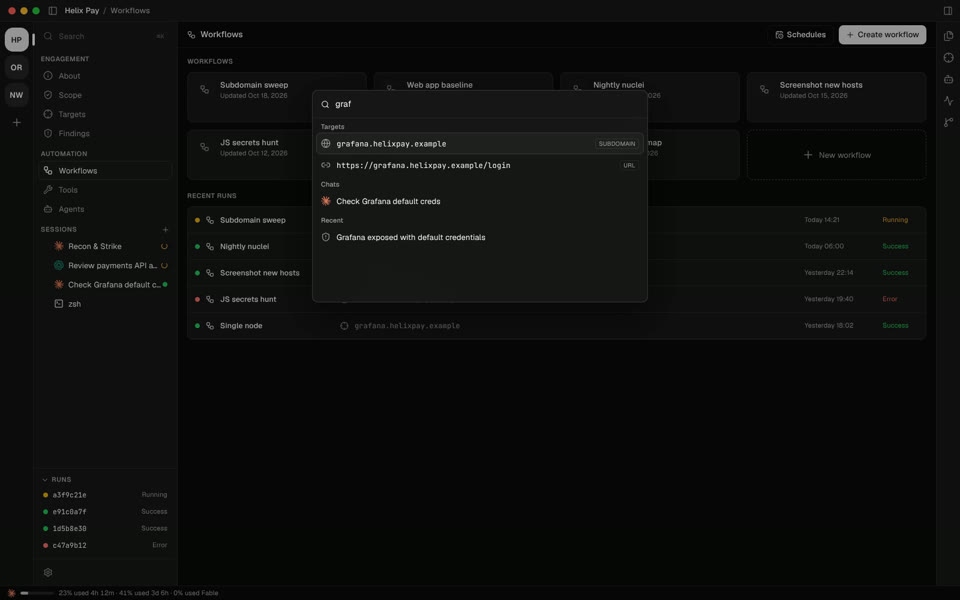</picture>
</td>
</tr>
</table>

## Your data stays on your machine

Executioner has no backend, so client data, credentials and exploit drafts stay on your disk.

An engagement is a folder. Scope, targets, findings, workflows, notes and evidence all live inside it, so you can copy it, back it up, zip it for the client, or put it under version control and review changes in the built-in source control panel.

Executioner drives the agent CLIs you already have installed and logged in. Tools run locally, on a remote box over SSH, or inside a Docker container such as Kali or Parrot. API keys for integrations like Shodan and Censys are stored locally and referenced by name in workflows.

The network traffic comes from two places you control: your tools talking to your targets, and each agent CLI talking to its own model provider under your account.

## Bring your own agent

<div align="center">
<table align="center">
<tr>
<td align="center"><br/><b>Claude Code</b></td>
<td align="center"><br/><b>Codex</b></td>
<td align="center"><br/><b>Gemini</b></td>
<td align="center"><br/><b>Cursor</b></td>
<td align="center"><br/><b>OpenCode</b></td>
<td align="center"><br/><b>Hermes</b></td>
</tr>
</table>
</div>

Pick a default during onboarding and switch per session. You can also run Claude agent teams, save agents with your own prompts, and point every agent at a shared folder of skills.

## The arsenal

| Recon | Web | Scanning | Network |
|---|---|---|---|
| Amass, dig, dnsx, Subfinder, theHarvester, wafw00f, WHOIS | Dalfox, Feroxbuster, ffuf, GAU, Gobuster, Gowitness, httpx, Katana, Nikto, sqlmap, WhatWeb, WPScan | Masscan, Naabu, Nmap, Nuclei, RustScan | Enum4linux, Hydra, MTR, Nbtscan, NetExec, Searchsploit, SSLScan, testssl.sh, Traceroute |

On the canvas they sit next to triggers (manual, schedule, on new target), logic (if, loop, merge, stop), AI agents, HTTP requests, screenshots, GeoIP, Shodan, Censys, notifications to Discord or Slack, and Python scripts. You can write your own nodes in Settings.

## A closer look

<table>
<tr>
<td width="50%">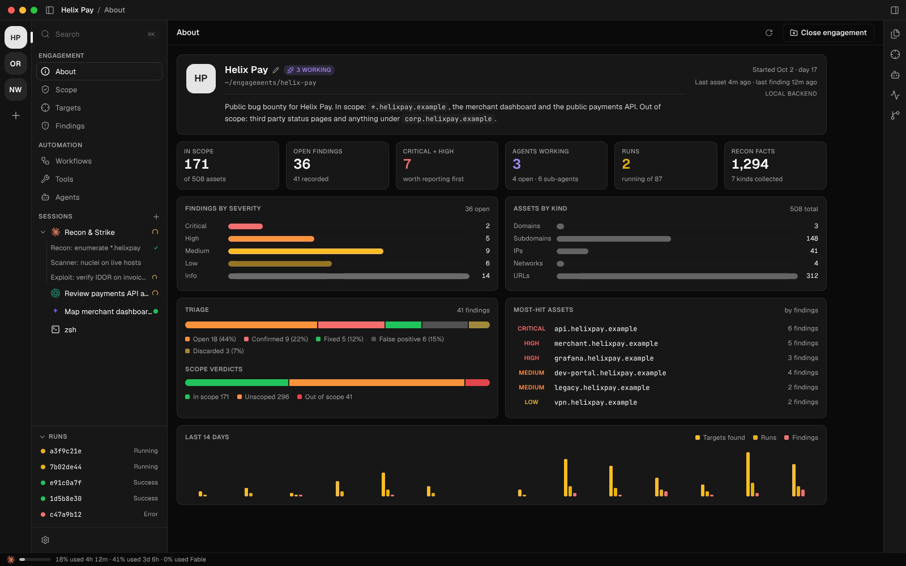</td>
<td width="50%">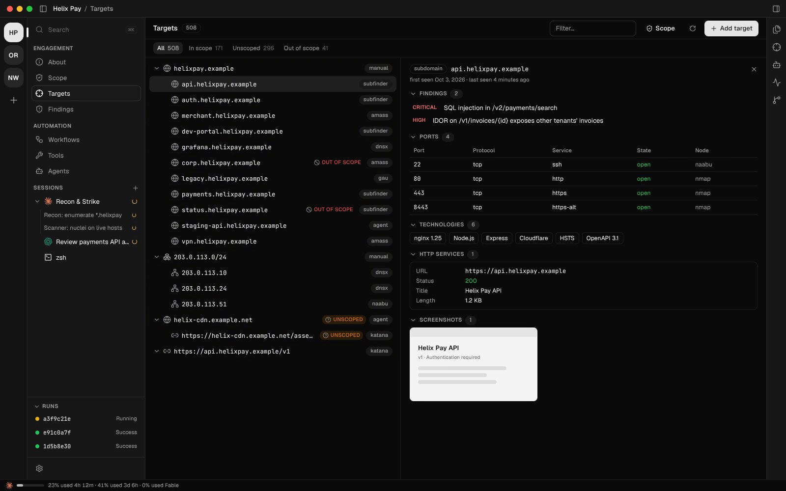</td>
</tr>
<tr>
<td width="50%">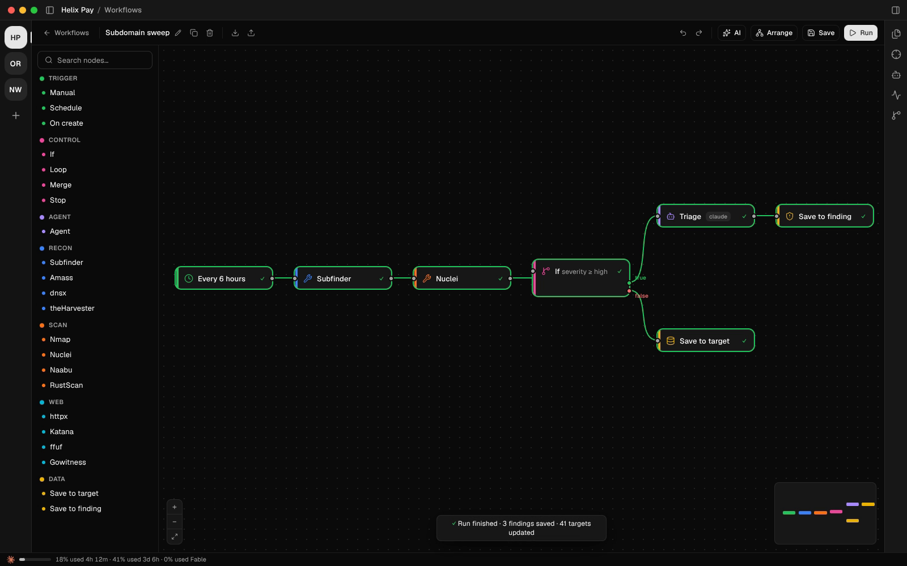</td>
<td width="50%">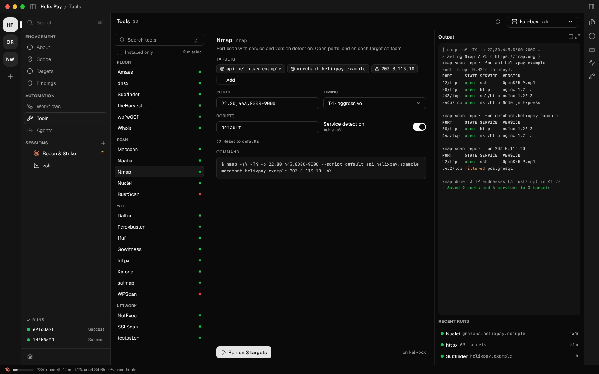</td>
</tr>
</table>

## Install

Grab the build for your platform from the [latest release](https://github.com/dbx0/executioner/releases/latest):

| Platform | Download |
|---|---|
| macOS (Apple silicon and Intel) | `.dmg` |
| Windows | `-setup.exe` |
| Linux | `.AppImage` or `.deb` |

Then install at least one agent CLI (Claude Code, Codex, Gemini, Cursor, OpenCode or Hermes) and the tools you plan to run. The onboarding walks you through the rest and tells you which tools are missing.

## Use it responsibly

Executioner is built for authorized security testing: bug bounty programs, pentests with a signed scope, CTFs and your own infrastructure. Only point it at systems you have explicit permission to test, and keep your scope rules up to date. You are responsible for what you run.

## Build from source

You need Node 24 and pnpm 12. `mise install` in the repo root pins both. On Linux, a C++ toolchain and Python are needed to compile the terminal module.

```bash
pnpm install
pnpm -r build
pnpm --filter @exe/desktop dev
```

Run the checks with `pnpm test`, `pnpm lint` and `pnpm typecheck`.

The README videos and screenshots are rendered from mockups with fictional data.


## License

MIT. See [LICENSE](LICENSE).
